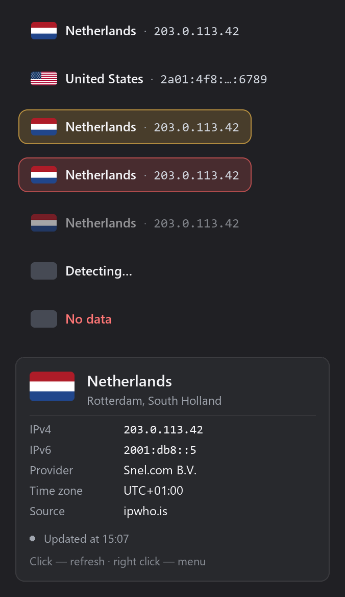

# IP widget for the Windows 11 taskbar

**English** · [Русский](README.md)

A small pill on the taskbar showing a flag, the country and your external IP, so you
can see at a glance whether the VPN is on. No installer, no frameworks: the window is
drawn with Win32 and Pillow.



## Features

- **Taskbar pill**: flag · country · IP, transparent background, soft hover
  highlight, text colour follows the dark/light theme instantly.
- **Hover tooltip**: city, region, provider, time zone, IPv4 and IPv6, last update
  time and which service answered.
- **Refreshes when it matters**: on a timer (1/5/10/30 min, hourly or manual) and
  **immediately when the network changes** (VPN on/off, Wi-Fi switch, resume from
  sleep). After a failure it retries by itself (15 → 30 → 60 → 120 → 300 s).
- **Change alerts**: the pill turns amber for 45 s when the IP or country changes.
  Set an "expected country" and it turns red whenever the country differs — handy to
  notice a dropped VPN.
- **Never loses data**: if a refresh fails, the last values stay but dim, and the
  tooltip says when they were fetched.
- **Finds free room on the taskbar** via UI Automation: avoids Start, icons, Widgets
  and the tray, and re-flows when icons move. Position: at the left edge or next to
  the icons.
- **Stays out of the way**: no flicker on taskbar clicks, never covers the Start menu,
  hides with auto-hide taskbars and in full-screen apps and games.
- Russian and English UI (system language or your choice), single instance,
  start-with-Windows toggle, survives an Explorer restart.

## Install

Download `IP-widget.exe` from **[Releases](https://github.com/zhgut777/ip-widget-taskbar/releases)**
(a SHA-256 file and a build attestation are published with it), or run from source:

```powershell
py -m pip install -r requirements.txt
pythonw ip_widget.pyw
```

Python 3.9+ and Pillow are required. If you ran v1.x, exit it first; your settings are
picked up and unknown keys are dropped.

## Usage

Hover — highlight, tooltip after ½ s · Click — refresh · Right click — menu (refresh,
auto-refresh period, copy IP / "country — IP", alerts, position, language, IPv4+IPv6,
start with Windows, open log folder, exit).

Settings live in `%APPDATA%\IPWidget\config.json` (edited through the menu; invalid
values fall back to defaults). Log: `%APPDATA%\IPWidget\widget.log` (rotated).

## Privacy

HTTPS only, certificates verified, every response validated. Requests go to
`ipwho.is` → `ipapi.co` → `ipinfo.io` (the last working one first), optionally
`api.ipify.org` / `api6.ipify.org` for the other address family (at most hourly), and
`flagcdn.com` for flags (once per country, then cached). Like any website they see
your external IP. No telemetry, no keys, no sign-up.

## Development

```powershell
py -m unittest discover -s tests -t .
py -m ipwidget --preview docs\my.png
powershell -ExecutionPolicy Bypass -File build.ps1
```

See the Russian README for the architecture notes. Limitations: primary taskbar only;
designed for the horizontal Windows 11 taskbar (Windows 10 and vertical taskbars are
untested — the pill parks above the taskbar edge when there is no room).

## License

[MIT](LICENSE)
