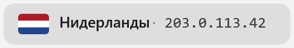
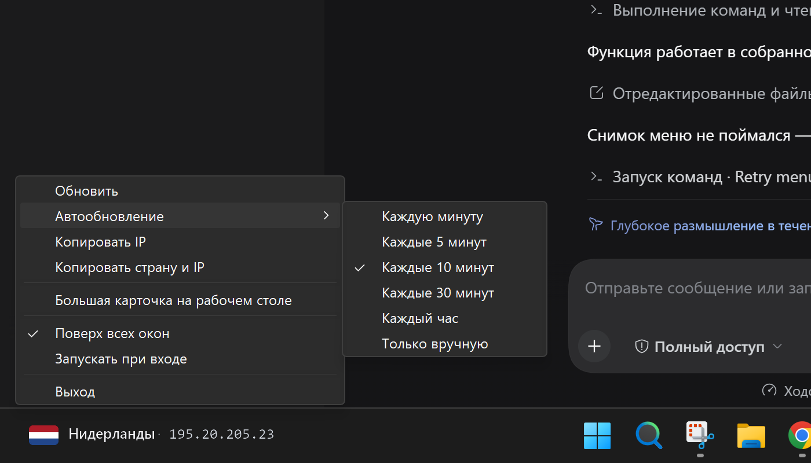
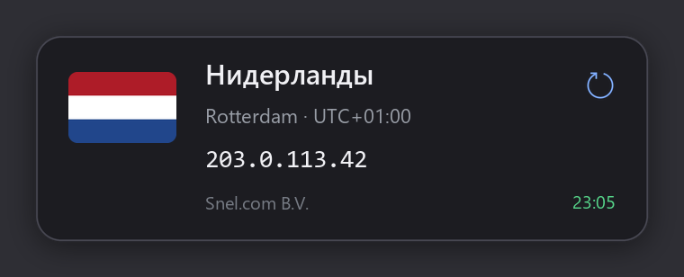

# IP-виджет для панели задач Windows 11

Маленький индикатор внешнего IP прямо в панели задач: флаг, страна и адрес.
Без установки, без фреймворков — окно рисуется через Win32 и Pillow.


Плашка без рамки и подложки: флаг, страна по-русски и IP лежат прямо на панели
задач. При наведении появляется мягкая подсветка.

В светлой теме текст автоматически становится тёмным, а меню — светлым:



## Возможности

- **два вида**: плашка в свободной левой части панели задач (по умолчанию) и
  большая карточка на рабочем столе — переключаются в меню;
- флаг страны, название по-русски, IP; в карточке ещё город, часовой пояс и
  провайдер;
- период автообновления настраивается из меню (1, 5, 10, 30 минут, час или
  только вручную), автообновление идёт молча — «Определяю…» появляется только
  при ручном обновлении, а при сбое сети на экране остаются последние данные;
- клик — обновить, правый клик — меню (обновить, автообновление, копировать IP,
  сменить вид, «поверх всех окон», «запускать при входе», выход);
- автоматически подстраивается под тёмную/светлую тему: цвет текста плашки
  (по цвету панели задач) и оформление меню — сразу при переключении, без
  перезапуска;
- не мигает при кликах по панели задач и не закрывает меню «Пуск»;
- прячется при автоскрытии панели и в полноэкранных приложениях, сам находит
  свободное место, если панель выровнена влево;
- кэш флагов и настроек, автозапуск, один экземпляр приложения.

## Установка

### Готовый exe

Скачайте `IP-widget.exe` со страницы
**[Releases](https://github.com/zhgut777/ip-widget-taskbar/releases)** — это один
файл без установки. Запустите, плашка появится в панели задач.

> exe собран PyInstaller (`--onefile`). Некоторые антивирусы настороженно
> относятся к самосборным onefile-программам — если это критично, запускайте
> из исходников.

### Из исходников

Нужен Python 3.9+ и Pillow:

```powershell
py -m pip install pillow
pythonw ip_widget.pyw        # без консоли
```

Или двойной щелчок по `ip-widget.vbs` — он сам найдёт `pythonw.exe`.

## Управление

| Действие | Плашка в панели задач | Карточка на столе |
|---|---|---|
| Одиночный щелчок | обновить данные | обновить данные |
| Перетаскивание мышью | — (привязана к панели) | переместить, позиция запоминается |
| Правый щелчок | меню | меню |

Период автообновления выбирается в меню **Автообновление** — от «Каждую минуту»
до «Каждый час» или «Только вручную»:



Данные обновляются автоматически с выбранным периодом, по умолчанию раз в 10 минут. Показывается **внешний** IP — тот,
который видит интернет (при включённом VPN это IP и страна VPN).

Карточка на рабочем столе:



## Сборка exe

```powershell
powershell -ExecutionPolicy Bypass -File build.ps1
```

Скрипт поставит PyInstaller, если его нет, и соберёт `dist\IP-widget.exe`.
Файл самодостаточный: Python внутри, ставить ничего не нужно.

## Как это устроено

Windows 11 не даёт сторонним программам встроить элемент *внутрь* панели задач
(deskband'ы из Windows 7/10 удалены). Поэтому плашка — прозрачное окно
(`WS_EX_LAYERED` + `UpdateLayeredWindow`), которое стоит поверх панели задач в
её пустой left-зоне и ведёт себя как часть панели:

- **владелец окна — панель задач** (`GWLP_HWNDPARENT`): окно-владелец всегда
  ниже своего окна, поэтому клик по панели не перекрывает плашку;
- позицию, видимость и тему панели виджет проверяет раз в секунду, а на смену
  активного окна и темы реагирует событиями (`EVENT_SYSTEM_FOREGROUND`,
  `WM_SETTINGCHANGE`);
- **тема**: тёмная/светлая тема читается из реестра Windows, реакция — на
  `WM_SETTINGCHANGE` («ImmersiveColorSet») и `WM_THEMECHANGED`; цвет текста
  подбирается по фактическому цвету панели задач, а меню переключается между
  светлым и тёмным через `uxtheme` (`SetPreferredAppMode` + `FlushMenuThemes`);
- кликабельна вся площадь плашки: под ней невидимая заливка с прозрачностью
  1/255 (сквозь полностью прозрачные пиксели Windows пропускает клики);
- меню открывается над плашкой, фокус после закрытия возвращается приложению.

## Ресурсы

Замеры на Windows 11, 200 % DPI, 14 логических ядер:

| Показатель | Значение |
|---|---|
| Холодный старт exe (до появления окна) | ~0,4 с |
| CPU в простое | 0 % (0 мс за 15 с) |
| Память | ~24 МБ private, ~40–45 МБ рабочего набора |
| Потоки | 5–6, все в ожидании; отдельный — только на время запроса |
| Пробуждения таймера | ~1 в секунду + события |
| Перерисовка при наведении | ~0,8 мс |
| Сеть | 1 запрос раз в 10 минут; флаг — один раз на страну |

За счёт кэшей фона, флага, готовых картинок и позиции плашки рендер с нуля
занимает ~0,4 мс вместо 9 мс, а карточка — ~2 мс вместо 158 мс.

## Настройки

`%APPDATA%\IPWidget\config.json`:

```json
{
  "mode": "bar",
  "x": 2328,
  "y": 1644,
  "topmost": true,
  "autostart": false,
  "interval_min": 10
}
```

- `mode` — `"bar"` (плашка в панели задач) или `"card"` (карточка на столе);
- `x`/`y` — позиция карточки в пикселях;
- `interval_min` — период автообновления в минутах (`0` — только вручную).

Кэш флагов: `%LOCALAPPDATA%\IPWidget\flags`, лог ошибок:
`%APPDATA%\IPWidget\widget.log`.

## Данные и приватность

IP и страна запрашиваются без ключей и регистрации, по очереди: `ipwho.is` →
`ipapi.co` → `ip-api.com` (резервный, по HTTP). Флаг берётся с `flagcdn.com`
по коду страны и кэшируется локально. Телеметрии нет, на диск пишутся только
настройки, кэш флагов и лог.

## Как убрать

1. Правый щелчок по плашке → **Выход**.
2. Удалите exe (или папку с исходниками).
3. Если включали автозапуск — снимите галочку **Запускать при входе** в меню
   перед выходом.
4. При желании удалите `%APPDATA%\IPWidget` и `%LOCALAPPDATA%\IPWidget`.
