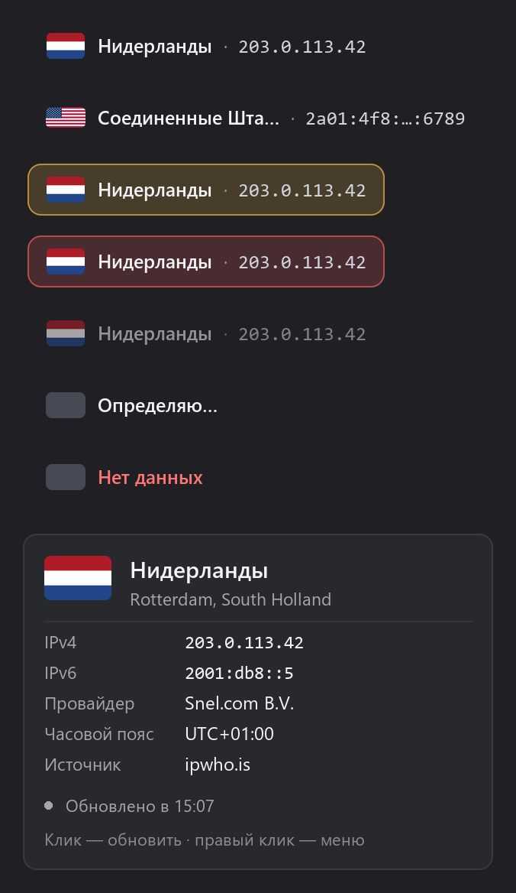

# IP-виджет для панели задач Windows 11

[English](README.en.md) · **Русский**

Маленькая плашка прямо на панели задач: флаг, страна и внешний IP. Видно сразу,
включён ли VPN и куда вы «выходите» в интернет. Без установки, без фреймворков —
окно рисуется через Win32 и Pillow.



## Возможности

- **Плашка на панели задач**: флаг · страна · IP. Фон прозрачный, при наведении
  мягкая подсветка. Цвет текста подстраивается под тёмную/светлую тему сразу при её
  переключении.
- **Подсказка при наведении**: город, регион, провайдер, часовой пояс, IPv4 и IPv6,
  время последнего обновления, какой сервис ответил.
- **Обновляется, когда нужно**: по таймеру (1, 5, 10, 30 минут, час или вручную) и
  **сразу при смене сети** — включили или выключили VPN, переключили Wi-Fi, компьютер
  проснулся после сна. После сбоя повторяет попытки сам (15 → 30 → 60 → 120 → 300 с).
- **Оповещения о смене IP/страны**: плашка на 45 секунд подсвечивается жёлтым. А если
  задать «ожидаемую страну», при несовпадении она краснеет и остаётся красной — так
  видно, что VPN отвалился.
- **Данные не пропадают**: если обновление не удалось, остаются прежние значения, но
  плашка тускнеет, а подсказка говорит, когда данные получены в последний раз.
- **Находит свободное место на панели** через UI Automation: объезжает «Пуск»,
  значки, «Виджеты» и трей, сама перестраивается, когда значки сдвигаются.
  Расположение можно выбрать: у левого края или рядом со значками.
- **Не мешает**: не мигает при кликах по панели, не закрывает меню «Пуск», прячется
  при автоскрытии панели и в полноэкранных приложениях и играх.
- **Два языка** интерфейса (русский, английский) — как в системе или по выбору.
- Один экземпляр, автозапуск из меню, пересоздаётся после перезапуска проводника
  (см. «Что не проверялось»).

## Установка

### Готовый exe

Скачайте `IP-widget.exe` со страницы
**[Releases](https://github.com/zhgut777/ip-widget-taskbar/releases)** и запустите.
Рядом в релизе лежит контрольная сумма SHA-256, а сборка делается в GitHub Actions
с подтверждением происхождения (attestation).

> exe собран PyInstaller (`--onefile`). Некоторые антивирусы настороженно относятся
> к таким файлам. Если это критично — запускайте из исходников.

### Из исходников

Нужен Python 3.9+ и Pillow:

```powershell
py -m pip install -r requirements.txt
pythonw ip_widget.pyw          # без консоли
py -m ipwidget --debug         # с подробным журналом
```

Или двойной щелчок по `ip-widget.vbs` — он сам найдёт `pythonw.exe`.

> Если у вас стояла версия 1.x — закройте её (правый щелчок → «Выход») перед запуском
> новой. Настройки (`%APPDATA%\IPWidget\config.json`) подхватятся, лишние ключи
> старой версии будут отброшены.

## Управление

| Действие | Что происходит |
|---|---|
| Наведение | подсветка, через полсекунды — подсказка с подробностями |
| Щелчок | обновить данные («Определяю…», прежние данные остаются при сбое) |
| Правый щелчок | меню |

Меню: обновить · период автообновления · копировать IP / «страна — IP» · оповещения
(подсвечивать смену, «ожидаемая страна») · положение на панели · язык · показывать
IPv4 и IPv6 · запускать при входе · открыть папку с журналом · выход.

## Настройки

`%APPDATA%\IPWidget\config.json` — меняются из меню, вручную править не нужно. Любое
неверное значение заменяется на значение по умолчанию, виджет из-за этого не падает.

```json
{
  "interval_min": 10,
  "language": "auto",
  "placement": "auto",
  "alert_on_change": true,
  "show_both_families": true,
  "expected_cc": ""
}
```

| Ключ | Значения |
|---|---|
| `interval_min` | `1`, `5`, `10`, `30`, `60`, `0` (только вручную) |
| `language` | `auto`, `ru`, `en` |
| `placement` | `auto`/`left` — у левого края; `right` — рядом со значками |
| `alert_on_change` | подсвечивать смену IP/страны |
| `show_both_families` | в подсказке показывать и IPv4, и IPv6 (второй адрес — доп. запрос) |
| `expected_cc` | код страны, например `"NL"`; пусто — выключено |

Журнал (с ротацией, до ~0,75 МБ): `%APPDATA%\IPWidget\widget.log`.
Кэш флагов: `%LOCALAPPDATA%\IPWidget\flags`.

## Данные и приватность

Виджет делает запросы **только по HTTPS с проверкой сертификата**; любой ответ
проверяется (IP — как адрес, страна — ровно две латинские буквы, строки очищаются
от служебных символов и обрезаются), так что подменённый или мусорный ответ не
попадёт ни на плашку, ни в путь к файлу.

| Что | Куда | Когда |
|---|---|---|
| Внешний IP, страна, город, провайдер | `ipwho.is` → `ipapi.co` → `ipinfo.io` | по очереди; последний рабочий идёт первым, упавший отдыхает 5 минут |
| «Второй» адрес (IPv4 ↔ IPv6) | `api.ipify.org` / `api6.ipify.org` | не чаще раза в час, можно отключить |
| Флаг страны | `flagcdn.com` | один раз на страну, дальше из кэша |

Эти сервисы, как и любой сайт, видят ваш внешний IP — для того он и запрашивается.
Телеметрии нет, ключей и регистрации не нужно. На диск пишутся только настройки,
кэш флагов и журнал. Каждый скачанный флаг проверяется как настоящий PNG.

## Как это устроено

Windows 11 не даёт сторонним программам встроить элемент *внутрь* панели задач
(deskband'ы из Windows 7/10 удалены), поэтому плашка — прозрачное окно
(`WS_EX_LAYERED` + `UpdateLayeredWindow`), которое стоит поверх панели в свободном
месте и ведёт себя как её часть:

- **владелец окна — панель задач**: окно-владелец всегда ниже своего окна, поэтому
  клик по панели не перекрывает плашку; пока открыто меню «Пуск» или быстрые
  настройки, плашка наверх не поднимается;
- **свободное место** находится через UI Automation (в Windows 11 всё содержимое
  панели рисует XAML, обычных дочерних окон там почти нет). Обход дерева занимает
  ~30 мс, поэтому он идёт в фоновом потоке и адаптивно: часто сразу после смены
  активного окна, редко (раз в 10 с), когда всё спокойно. Собственные окна виджета
  из занятых областей исключаются. Если UI Automation недоступен, используется
  запасной способ по окнам панели;
- **тема**: основной источник — реестр (`SystemUsesLightTheme`); если на панель
  выведен акцентный цвет, смотрим на яркость реальных пикселей с гистерезисом,
  чтобы текст не моргал;
- **сеть**: подписка на `NotifyIpInterfaceChange` / `NotifyRouteChange2` с
  отложенным опросом (ждём 4 с, пока сеть «успокоится»), плюс `WM_POWERBROADCAST` для
  выхода из сна;
- окно, принадлежащее панели, умирает вместе с ней — при перезапуске проводника
  виджет ждёт новую панель и создаёт плашку заново;
- отрисовка — Pillow, текст и флаги через маски с корректной альфой (без тёмной
  каймы по краям букв); готовые картинки кэшируются.

Структура:

```
ipwidget/
  app.py        окно, таймеры, меню, подсказка, обновление данных
  taskbar.py    состояние панели, тема, поток поиска свободного места
  uia.py        минимальный клиент UI Automation на ctypes
  netinfo.py    сервисы IP, проверка ответов, кэш флагов
  netwatch.py   уведомления Windows о смене сети
  render.py     отрисовка плашки и подсказки (чистый Pillow)
  state.py      чистая логика: повторы, «изменилось», оповещения
  layout.py     поиск свободного промежутка (чистая функция)
  config.py     настройки с проверкой значений
  i18n.py       строки и названия стран
  winapi.py     Win32-привязки,  system.py — реестр, буфер обмена, автозапуск
tests/          модульные тесты (python -m unittest)
```

## Ресурсы

Замеры на Windows 11 (сборка 26300), 200 % масштаб, один экземпляр в простое:
CPU ≈ 0,1–0,3 % (в основном фоновый обход панели и события мыши), память ≈ 22 МБ
private / ≈ 46 МБ рабочий набор, 12 потоков (в основном ожидание). Холодный запуск
и потребление на других машинах не измерялись.

## Разработка

```powershell
py -m unittest discover -s tests -t .        # тесты (≈ 60, Windows)
py -m ipwidget --preview docs\my.png         # картинки состояний без окна
set IPW_INSTANCE=dev & py -m ipwidget --debug  # отдельный экземпляр: свои настройки и журнал
powershell -ExecutionPolicy Bypass -File build.ps1   # dist\IP-widget.exe + SHA-256
```

CI (GitHub Actions): тесты на Python 3.9–3.13 при каждом push; по тегу `vX.Y.Z` —
сборка exe, контрольная сумма и публикация в Releases.

## Что не проверялось на живой системе

Всё ниже реализовано, но запускалось только на одной машине (Windows 11, сборка 26300,
масштаб 200 %, тёмная тема, панель внизу со значками по центру). Проверено вживую:
показ плашки, подсказка, меню, подсветка, повторы после сбоя, реакция на сообщение о
смене сети, выход, собранный exe. **Не проверялось**: перезапуск проводника,
полноэкранные приложения и автоскрытие панели, выход из сна, переключение темы «на
лету», масштабы 100/150 %, несколько мониторов, панель Windows 10, настоящие события
`NotifyIpInterfaceChange` (проверялось отправкой того же сообщения окну), сборка в
GitHub Actions и Python 3.9.

## Ограничения

- Работает с основной панелью задач (на дополнительных мониторах плашки нет).
- Рассчитано на горизонтальную панель Windows 11; на Windows 10 и вертикальной
  панели плашка «паркуется» над краем панели, это не проверялось.
- Если на панели нет свободного места нужной ширины, плашка встаёт над её краем.

## Как убрать

1. Правый щелчок по плашке → **Выход** (сначала снимите «Запускать при входе»).
2. Удалите exe (или папку с исходниками).
3. При желании удалите `%APPDATA%\IPWidget` и `%LOCALAPPDATA%\IPWidget`.

## Лицензия

[MIT](LICENSE)
